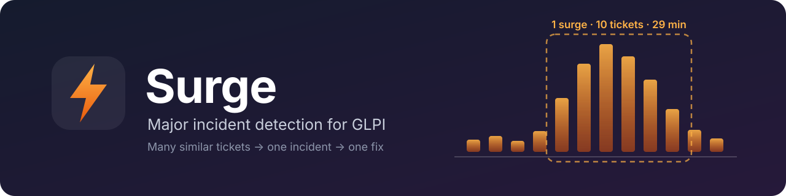
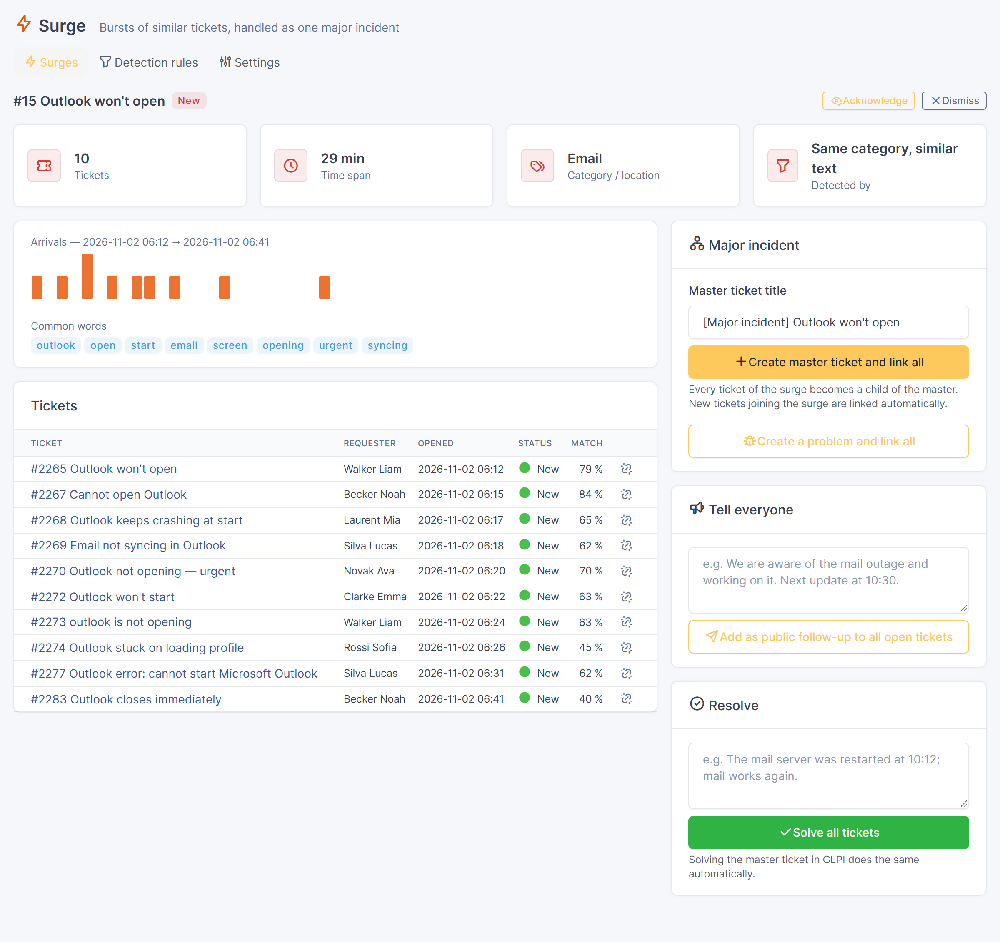
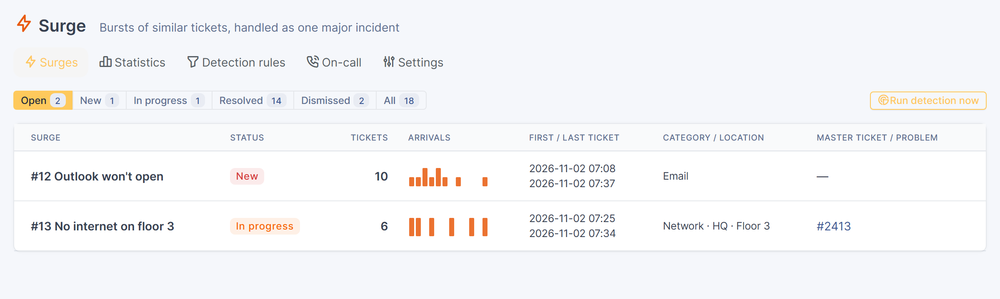
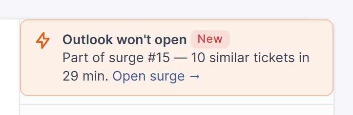
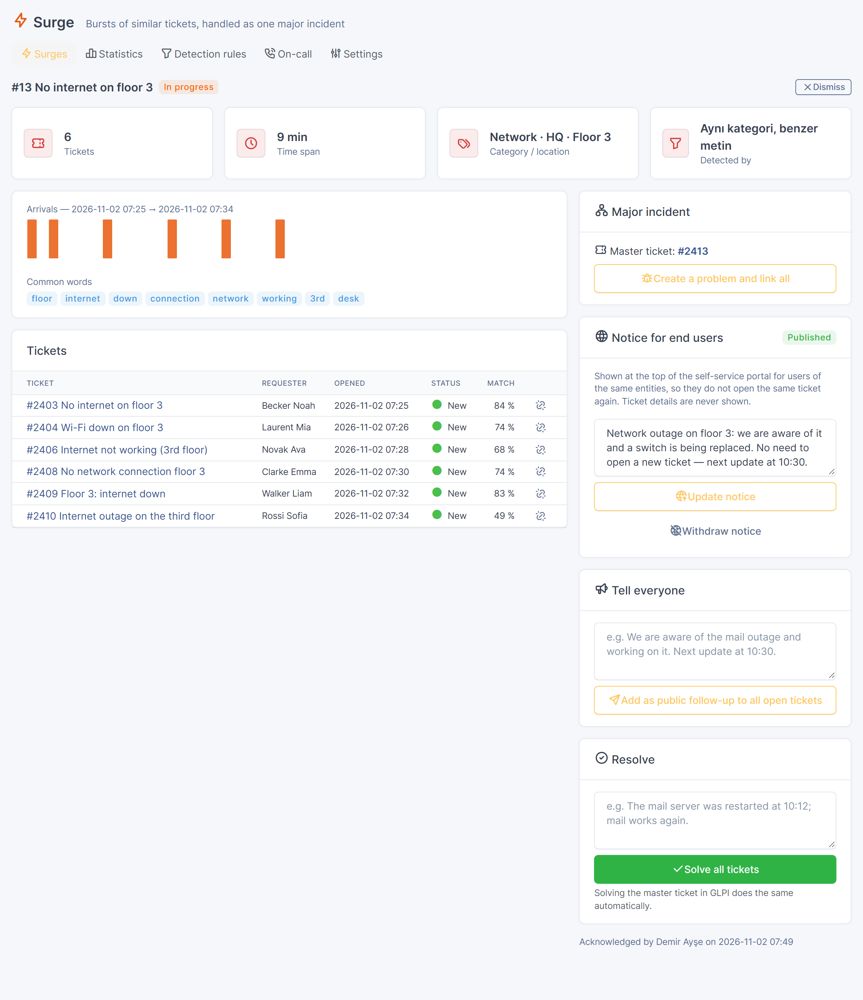
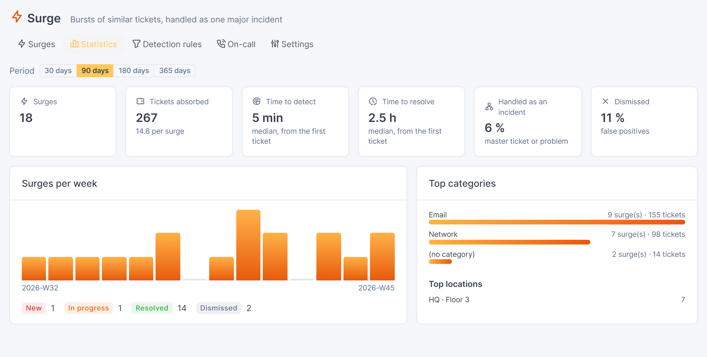
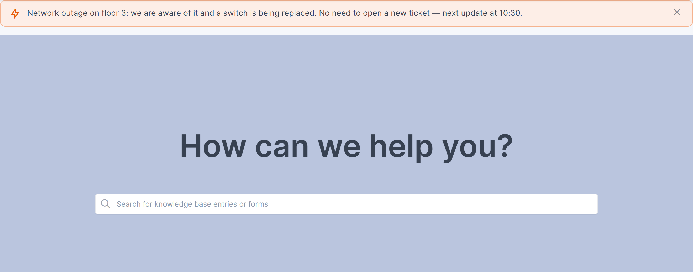
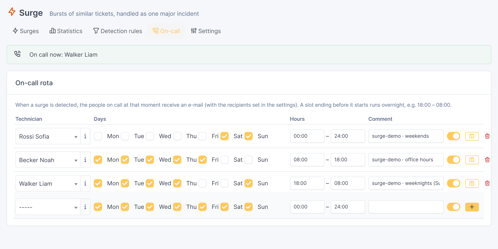
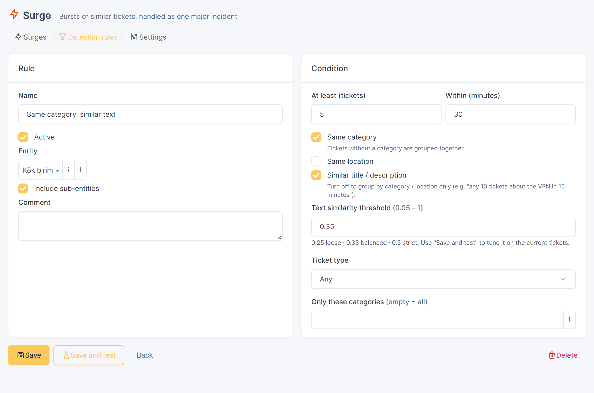
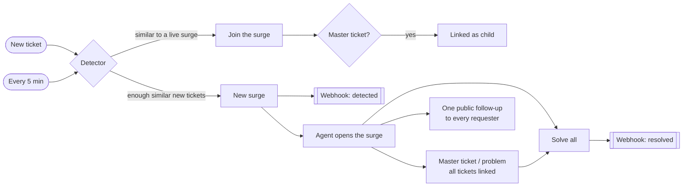

<p align="center">
  
</p>

<p align="center">
  <a href="https://github.com/CodeByPinar/glpi-surge/releases"><picture><source media="(prefers-color-scheme: dark)" srcset="docs/readme/badges-dark.svg"></picture></a>
</p>

<p align="center">
  <picture><source media="(prefers-color-scheme: dark)" srcset="docs/readme/tagline-dark.svg"></picture>
</p>

<p align="center">
  <a href="#-why-surge"><picture><source media="(prefers-color-scheme: dark)" srcset="docs/readme/nav-why-dark.svg"></picture></a>
  <a href="#-features"><picture><source media="(prefers-color-scheme: dark)" srcset="docs/readme/nav-features-dark.svg"></picture></a>
  <a href="#%EF%B8%8F-how-it-works"><picture><source media="(prefers-color-scheme: dark)" srcset="docs/readme/nav-how-dark.svg"></picture></a>
  <a href="#-installation"><picture><source media="(prefers-color-scheme: dark)" srcset="docs/readme/nav-install-dark.svg"></picture></a>
  <a href="#%EF%B8%8F-configuration"><picture><source media="(prefers-color-scheme: dark)" srcset="docs/readme/nav-config-dark.svg"></picture></a>
  <a href="#-faq"><picture><source media="(prefers-color-scheme: dark)" srcset="docs/readme/nav-faq-dark.svg"></picture></a>
  <a href="#%EF%B8%8F-roadmap"><picture><source media="(prefers-color-scheme: dark)" srcset="docs/readme/nav-roadmap-dark.svg"></picture></a>
</p>

---

## 💡 Why Surge

When the mail server goes down, the service desk does not receive *one* ticket. It receives this:

```text
09:12  Outlook won't open                      09:21  Outlook not opening — urgent
09:14  Cannot open Outlook                     09:23  outlook is not opening
09:15  Outlook keeps crashing at start         09:25  Outlook stuck on loading profile
09:17  Email not syncing in Outlook            09:31  Outlook error: cannot start Microsoft Outlook
09:19  Printer on floor 2 out of toner         09:41  Outlook closes immediately
```

Each L1 agent sees two or three of them and answers them one by one. Nobody looks at the whole picture until much
later. By then the same diagnosis has been typed ten times, requesters got ten different answers, and the problem
record (if anyone opens one) is missing half of the affected tickets.

**Surge** watches the queue for you. It recognises that nine of these tickets are the same incident — and that the
printer is not — and turns them into a single **surge** you can act on:

| Without Surge | With Surge |
|---|---|
| The incident is noticed when someone happens to look | Detected as the tickets arrive, with an optional Slack / Teams alert |
| 10 tickets, 10 investigations, 10 different answers | One master ticket; every ticket linked as a child |
| Requesters chased one by one for updates | One public follow-up reaches every requester |
| Each ticket closed by hand when the fix is in | Solve the master ticket → every linked ticket is solved |
| Problem record built from memory | One click: problem created and linked to all tickets |

---

## ✨ Features

<table>
<tr>
<td width="50%" valign="top">

**🔎 Real-time detection**
Runs when each ticket is created, plus an automatic action every 5 minutes as a safety net. The surge exists
while the burst is still happening.

**🧠 Understands messy, multilingual titles**
Diacritic folding, stop words, prefix stemming and TF-IDF match *"Outlook won't open"*, *"OUTLOOK NOT
OPENING — urgent"* and *"Email not syncing in Outlook"*. A printer ticket in the same category stays out.

**🎛️ Rules you can tune — and test**
Time window, minimum count, same category / location, similarity threshold, ticket type, categories, entity.
**Save and test** shows what a rule would group *right now*, without creating anything.

**🧬 Optional semantic matching** <sup>0.2</sup>
Plug in a local embedding model (Ollama, llama.cpp…) and *"cannot log in to the VPN"* joins *"remote access
authentication failed"* — no shared words needed.

**📊 Statistics** <sup>0.2</sup>
Time to detect, time to resolve, tickets absorbed per incident, false-positive rate, top categories and locations,
surges per week.

</td>
<td width="50%" valign="top">

**🚨 One click to a major incident**
Creates a master ticket and links every ticket to it as *son of*. Tickets that arrive later are linked
automatically. You can also open a **problem** and link everything to it.

**📣 Tell everyone, solve once**
One public follow-up goes to every open ticket, and GLPI notifies the requesters as usual. Solving the master
ticket solves every linked ticket with the same solution.

**🌐 Stop the duplicates at the source** <sup>0.2</sup>
Publish a notice on the self-service portal — *"We are aware of the network outage on floor 3"* — so users stop
opening the same ticket. It turns into *"resolved"* when you fix it.

**📟 On-call & alerts** <sup>0.2</sup>
A built-in on-call rota: whoever is on duty (plus fixed recipients) is e-mailed through GLPI's own notification
queue. Webhooks go to Slack, Microsoft Teams or any HTTP endpoint. A banner on every ticket of a surge tells the
agent what is going on.

</td>
</tr>
</table>

- **Private by design.** Detection is plain PHP running inside GLPI. No cloud AI and no external call. Semantic
  matching is opt-in and talks only to a model *you* host, and webhooks are opt-in too.
- **Respects GLPI rights.** Every action checks the user's right on each ticket. Tickets the user cannot update are
  skipped and reported. Portal notices show only the text an agent wrote, never ticket details.
- **One code base for GLPI 11 and GLPI 12.** 6 languages: English, French, German, Spanish, Portuguese (Brazil) and
  Turkish.

---

## 📸 Screenshots

<table>
<tr>
<td colspan="2" align="center">
<br>
<sub><b>A detected surge.</b> Ten tickets in 29 minutes, each with its similarity to the incident, plus the arrival chart, common words and the actions.</sub>
</td>
</tr>
<tr>
<td width="50%" align="center" valign="top">
<br>
<sub><b>Surges list</b> with arrival sparklines.</sub>
</td>
<td width="50%" align="center" valign="top">
<br>
<sub><b>Ticket banner.</b> Agents see at once that a ticket is part of a surge.</sub>
</td>
</tr>
<tr>
<td width="50%" align="center" valign="top">
<br>
<sub><b>Major incident in progress.</b> The master ticket is created and every ticket is linked.</sub>
</td>
<td width="50%" align="center" valign="top">
<br>
<sub><b>Statistics.</b> Time to detect, tickets absorbed, top categories, surges per week.</sub>
</td>
</tr>
<tr>
<td colspan="2" align="center">
<br>
<sub><b>Notice on the self-service portal.</b> End users learn about the outage before opening yet another ticket.</sub>
</td>
</tr>
<tr>
<td width="50%" align="center" valign="top">
<br>
<sub><b>On-call rota.</b> Weeknights, weekends, office hours — whoever is on duty gets the e-mail.</sub>
</td>
<td width="50%" align="center" valign="top">
<br>
<sub><b>Detection rule</b> with a dry-run test on current tickets.</sub>
</td>
</tr>
</table>

---

## ⚙️ How it works



### Detection, step by step

For each active **detection rule**:

1. **Candidates.** Surge collects the open tickets created within the rule's time window, in the rule's entities, that
   are not already part of a surge.
2. **Join.** A candidate that is similar enough to a *live* surge joins it, provided it has the same category and
   location when the rule asks for them. If that surge already has a master ticket, the new ticket is linked to it.
3. **Group.** The remaining candidates are grouped by category and location, then clustered by text similarity.
4. **Create.** Every cluster with at least `min_tickets` tickets becomes a new surge, named after its most typical
   ticket.

### Text similarity

| Step | What it does | Example |
|---|---|---|
| Normalise | Strip HTML, lower-case, fold diacritics (Turkish ı/İ/ğ/ş/ç/ö/ü and Latin accents) | `İNTERNET YOK` → `internet yok` |
| Tokenise | Words of 3+ characters, minus English / Turkish / service-desk stop words | `Hello, please help: the printer` → `printer` |
| Stem | Keep the first 6 characters; merges suffixes of agglutinative languages and English inflections | `bağlanamıyorum`, `bağlantı` → `baglan` |
| Weight | TF-IDF against the **latest 1000 tickets**; title words count twice | `outlook` is rare in everyday tickets but shared by the burst, so it weighs a lot |
| Compare | Cosine similarity, then single-linkage clustering (a chain of similar pairs is one group) | see below |

The background corpus is the key detail. If word weights were computed on the burst alone, the word everybody
shares (*outlook*) would look like noise and the incident would be split into small pieces.

These are the scores from the demo data shown in the screenshots (rule: same category, threshold 0.35):

| Ticket | Match | |
|---|---:|---|
| Cannot open Outlook | 84 % | ✅ in the surge |
| Outlook won't open | 79 % | ✅ |
| Outlook not opening — urgent | 70 % | ✅ |
| Outlook keeps crashing at start | 65 % | ✅ |
| Email not syncing in Outlook | 62 % | ✅ |
| Outlook closes immediately | 40 % | ✅ |
| Printer on floor 2 out of toner | — | ➖ not grouped |
| Password reset for the HR portal | — | ➖ not grouped |

### Semantic similarity (optional)

Words are not everything: *"cannot log in to the VPN"* and *"remote access authentication failed"* share no word at
all. With **semantic similarity** enabled (Settings), Surge also asks an embedding model that **you host** for a
vector per ticket and blends both scores:

```text
similarity = (1 − w) · TF-IDF cosine  +  w · embedding cosine        (w = 0.5 by default)
```

- Any OpenAI-compatible `/v1/embeddings` endpoint works: [Ollama](https://ollama.com) (`nomic-embed-text`,
  `mxbai-embed-large`, `bge-m3`…), llama.cpp `llama-server --embeddings`, LocalAI, vLLM.
- Only the ticket title and the beginning of the description are sent. Vectors are cached per ticket and model.
- If the endpoint is down, detection silently falls back to TF-IDF (the error is logged in `files/_log/surge.log`).
- **Save and test the connection** on the settings page shows the dimensions, the latency and how close two
  paraphrases are.

Every member's score is shown on the surge page. A wrong member can be removed with one click and will never be added
back.

---

## 📦 Installation

**Requirements:** GLPI 11.0+ or 12.0+ · PHP 8.2+ · GLPI cron configured (for the 5-minute safety net).

### From a release (recommended)

Download `surge-<version>.tgz` from [Releases](https://github.com/CodeByPinar/glpi-surge/releases), then:

```bash
cd /var/www/glpi/plugins
sudo tar xzf /tmp/surge-0.1.0.tgz
sudo chown -R www-data:www-data surge
```

```bash
# GLPI 11
sudo -u www-data php /var/www/glpi/bin/console glpi:plugin:install surge -u <admin>
sudo -u www-data php /var/www/glpi/bin/console glpi:plugin:activate surge

# GLPI 12
sudo -u www-data php /var/www/glpi/bin/console plugin:install surge -u <admin>
sudo -u www-data php /var/www/glpi/bin/console plugin:activate surge
```

…or open **Setup → Plugins** and click **Install**, then **Enable**.

### Try it with Docker

Every release publishes GLPI images with Surge preinstalled to the
[GitHub Container Registry](https://github.com/CodeByPinar/glpi-surge/pkgs/container/glpi-surge). They are built on the
[official GLPI image](https://github.com/glpi-project/docker-images).

| Image | GLPI |
|---|---|
| `ghcr.io/codebypinar/glpi-surge:glpi11` · `:<version>-glpi11` · `:latest` | 11.0 |
| `ghcr.io/codebypinar/glpi-surge:glpi12` · `:<version>-glpi12` | 12.0 |

```bash
curl -O https://raw.githubusercontent.com/CodeByPinar/glpi-surge/main/docker/docker-compose.yml
docker compose up -d          # GLPI installs itself on first start (about a minute)
```

Open <http://localhost:8080>, sign in with `glpi` / `glpi`, then enable the plugin once:

```bash
docker compose exec -u www-data glpi php /var/www/glpi/bin/console glpi:plugin:install surge -u glpi
docker compose exec -u www-data glpi php /var/www/glpi/bin/console glpi:plugin:activate surge
# GLPI 12 image: use plugin:install / plugin:activate
```

> [!WARNING]
> This setup is for evaluation only: change the default passwords before exposing it anywhere.

### From source

```bash
cd /var/www/glpi/plugins
sudo git clone https://github.com/CodeByPinar/glpi-surge.git surge
sudo chown -R www-data:www-data surge
```

> [!NOTE]
> The plugin folder **must** be named `surge`.

### Upgrade · uninstall

- **Upgrade:** replace the folder and run *install* and *activate* again. Rules, surges, settings and rights are kept;
  upgrades only add what is missing.
- **Uninstall:** *Setup → Plugins → Surge → Uninstall*. Removes Surge's tables, settings, rights and automatic action.
  Your tickets, links and problems are never touched.

---

## 🚀 Quick start

1. **Assistance → Surge → Detection rules.** A default rule is already active: *5 or more open tickets in 30 minutes,
   same category, similar text*.
2. *(Optional)* **Assistance → Surge → Settings.** Paste a Slack / Teams webhook URL.
3. Wait for a burst, or open a rule and press **Save and test** to see what it would group right now.
4. Open the surge, then **Create master ticket and link all**.
5. Use **Tell everyone** for updates. When it is fixed, **solve the master ticket**: every linked ticket is solved.

---

## 🛠️ Configuration

### Detection rule

| Field | Default | Meaning |
|---|---|---|
| At least (tickets) | 5 | Minimum size of a new surge |
| Within (minutes) | 30 | Look-back window for new tickets |
| Same category | ✔ | Only tickets of the same ITIL category are grouped |
| Same location | ✘ | Only tickets of the same location are grouped (great for "floor 3 is down") |
| Similar title / description | ✔ | Turn off to group by category / location only |
| Similarity threshold | 0.35 | 0.25 loose · 0.35 balanced · 0.5 strict |
| Ticket type | Any | Any / incidents only / requests only |
| Only these categories | all | Restrict a rule to some categories |
| Entity, sub-entities | root, ✔ | Where the rule applies |

Several rules can run side by side. For example, a sensitive network rule (*3 tickets in 10 minutes, same location*)
can run next to the default one.

### Settings

| Setting | Default | |
|---|---|---|
| Master ticket urgency / impact | High / High | Used for the master ticket and the problem |
| Solving the master solves every linked ticket | ✔ | The solution text is copied to each open member |
| Link late tickets to the master automatically | ✔ | Tickets joining after the master was created become its children |
| Surge keeps collecting tickets for | 24 h | After its last ticket |
| Webhook URL / format | — / generic | Generic JSON, Slack or Microsoft Teams (workflow) |
| E-mail: users, groups | — | Fixed recipients when a surge is detected |
| E-mail whoever is on call | ✔ | Uses the **On-call** rota (days, hours, overnight slots) |
| Show notices to central-interface users | ✘ | By default notices appear on the self-service portal only |
| Keep a resolved notice for | 2 h | Shown as *"Resolved: …"*, then hidden |
| Semantic similarity: endpoint, model, key, weight | off | See *How it works* |

### Notices for end users

On a surge page, **Notice for end users** publishes a short text written by the agent (a suggestion is pre-filled).
It appears at the top of every self-service page for users of the surge's entities, can be dismissed by the user for
their session, and switches to *"Resolved: …"* when the surge is solved. Ticket titles, requesters and other details
are **never** shown.

### On-call and e-mail

**Assistance → Surge → On-call** holds a simple rota: technician, days, hours (`18:00 – 08:00` runs overnight). When
a surge is detected, whoever is on call — plus the fixed users / groups from the settings — gets an e-mail with the
tickets and a link. Messages go through GLPI's **notification queue** and mail settings, so retries and the
*Notification queue* screen work as usual. Nothing is sent while GLPI e-mail notifications are disabled.

### Rights — *Administration → Profiles → Surge*

| Right | Allows | Given on install to |
|---|---|---|
| See surges | Surge list, surge pages, ticket banner | all central-interface profiles |
| Handle surges | Acknowledge, master ticket, problem, broadcast, solve, dismiss, remove a ticket | all central-interface profiles |
| Detection rules and settings | Rules and settings pages | profiles that can edit GLPI's configuration |

### Webhook payload

<details>
<summary><b>Generic JSON</b> (click to expand)</summary>

```json
{
  "event": "detected",
  "surge": {
    "id": 12,
    "name": "Outlook won't open",
    "status": "new",
    "tickets": 9,
    "first": "2026-11-02 09:14:00",
    "last": "2026-11-02 09:27:00",
    "category": "Email",
    "location": "",
    "master_ticket": null,
    "problem": null,
    "url": "https://glpi.example.com/plugins/surge/front/surge.form.php?id=12"
  },
  "text": "⚡ Surge detected: \"Outlook won't open\" — 9 tickets · Email — https://…"
}
```

`event` is one of `detected`, `master`, `resolved`.
</details>

<details>
<summary><b>Slack / Microsoft Teams</b></summary>

```json
{ "text": "⚡ Surge detected: \"Outlook won't open\" — 9 tickets · Email — https://glpi.example.com/plugins/surge/front/surge.form.php?id=12" }
```

Slack: use an *Incoming Webhook* URL. Teams: use a *Workflows* "Post to a channel when a webhook request is
received" URL. GLPI's proxy settings are applied.
</details>

---

## ❓ FAQ

<details>
<summary><b>Does Surge change my tickets on its own?</b></summary>

Only links. When a surge already has a master ticket, new members are linked to it (you can turn this off). Everything
else is triggered by an agent: creating the master ticket or problem, broadcasting, solving, and the cascade from
solving the master ticket.
</details>

<details>
<summary><b>What about false positives?</b></summary>

Use **Dismiss** on the surge (the tickets stay untouched), or remove a single ticket with the unlink button. A removed
ticket is never added back. To make a rule stricter, raise the similarity threshold or the minimum count, or require
the same location. **Save and test** shows the effect immediately.
</details>

<details>
<summary><b>Does it need an AI model or an internet connection?</b></summary>

No. The default similarity is classic information retrieval (TF-IDF + cosine) implemented in a few hundred lines of PHP.
It is fast, explainable (you see each ticket's score) and nothing leaves your server. Semantic matching is an optional
extra that uses an embedding model **you** run; it is off by default.
</details>

<details>
<summary><b>Which languages does detection work with?</b></summary>

Any language written with spaces between words. Stop words and diacritic folding are tuned for English and Turkish.
Prefix stemming works well for agglutinative languages (Turkish, Finnish, Hungarian…) and is a reasonable
approximation for others. Pull requests with stop words for more languages are welcome.
</details>

<details>
<summary><b>How heavy is it?</b></summary>

Each run looks at the open tickets of the time window (capped at 400 per rule) and the word statistics of the latest
1000 tickets, cached per request. On a normal service desk this takes milliseconds. Detection runs once per created
ticket and once every 5 minutes.
</details>

<details>
<summary><b>Can end users see surges?</b></summary>

They see only what an agent publishes as a **notice** (see *Configuration*), never the surge itself or its tickets.
The surge pages are for central-interface profiles with the Surge rights.
</details>

---

## 🧭 Compatibility

| | GLPI 11.0.x | GLPI 12.0.x |
|---|:---:|:---:|
| Surge 0.1 – 0.3 | ✅ tested | ✅ tested |

Tested with MariaDB / MySQL as shipped with GLPI. The same archive installs on both versions.

---

## 🗺️ Roadmap

Done in 0.2:

- [x] Self-service notice: *"We are aware of the mail outage"* on the end-user portal
- [x] Statistics: time to detect, tickets absorbed per incident, top surge categories
- [x] Notify the on-call technician (built-in on-call rota)
- [x] Optional semantic similarity with a local embedding model, on top of TF-IDF
- [x] More languages for stop words and the user interface (FR, DE, ES, PT-BR)
- [x] GLPI plugin catalogue descriptor (`plugin.xml`)

Next:

- [ ] Suggest the matching notice while an end user is writing a new ticket
- [ ] Merge two surges / move a ticket between surges
- [ ] Export statistics (CSV) and a dashboard card
- [ ] Listing on the GLPI Marketplace

Ideas and feedback are welcome in [Issues](https://github.com/CodeByPinar/glpi-surge/issues).

---

## 🧑‍💻 Development

```text
setup.php · hook.php     declaration, install / uninstall (additive upgrades)
src/Text.php             normalisation, stemming, TF-IDF, cosine, clustering
src/Detector.php         candidates, joining live surges, new surges, IDF background
src/Surge.php            surge data, actions, automatic action
src/Rule.php · Config.php   detection rules, settings
src/TicketHooks.php      detection on ticket creation, cascading solutions, ticket banner
src/Notifier.php         webhooks
src/Events.php           extension points for other plugins (docs/EXTENDING.md)
src/Mailer.php · OnCall.php   e-mail through GLPI's queue, on-call rota
src/Embeddings.php       optional semantic similarity (OpenAI-compatible /v1/embeddings, cached vectors)
front/                   pages (surges, surge, statistics, rules, on-call, settings, notice JSON)
locales/                 surge.pot · en_GB · fr_FR · de_DE · es_ES · pt_BR · tr_TR
tools/                   i18n.py (extract, merge, compile), package.py (release archives)
tests/                   integration tests and demo data for a GLPI test instance
```

- **Tests.** `tests/surge_test.php` has 27 checks: text processing, detection, every action and the cascade.
  `tests/surge_v2_test.php` has 36: languages, on-call slots, e-mail queue, notices, statistics, semantic matching
  (with `tests/embed_mock.py`).
  `tests/surge_v3_test.php` has 14: the extension points. `tests/surge_demo_test.php` has 32: demo data load / remove.
  `tests/surge_pages.sh` has 48: every page, every POST action and the rights. Both pass on GLPI 11 and 12. They expect
  a disposable GLPI instance with a small CLI boot helper. **Never run them on production.**
- **Demo data.** *Settings → Demo data* loads (and removes) the scenario used in the screenshots in one click.
  `php tests/demo.php <instance> create|clean` does the same from the command line on a test instance.
- **Translations.** `python tools/i18n.py` extracts strings to `locales/surge.pot`, merges translations from
  `tools/<lang>.json` and compiles the `.mo` files. No gettext tools are needed.
- **Release.** Bump `PLUGIN_SURGE_VERSION` and the changelog, run `python tools/readme_assets.py` (header badges), then push
  a tag `vX.Y.Z`. GitHub Actions builds the
  archives (`tools/package.py`), publishes the GitHub Release and pushes the GLPI 11 / 12 Docker images to GHCR.

- **Extending.** Other plugins can listen to surge events and add tabs or cards: see [docs/EXTENDING.md](docs/EXTENDING.md).

See [CONTRIBUTING.md](CONTRIBUTING.md) for how to propose changes and add a language.

---

## 📬 Contact

Questions, bug reports you would rather not post publicly, or commercial support (installation, custom rules, integration): **[info@itsmplugins.com](mailto:info@itsmplugins.com)**. Bugs and ideas are also welcome as [GitHub issues](https://github.com/CodeByPinar/glpi-surge/issues).

---

## 📄 License

Surge is free software, released under the [GNU General Public License v3.0 or later](LICENSE).

<p align="center"><sub>Made with ☕ by <a href="https://github.com/CodeByPinar">Pınar Topuz</a> · If Surge saves your service desk a busy morning, a ⭐ is much appreciated.</sub></p>
